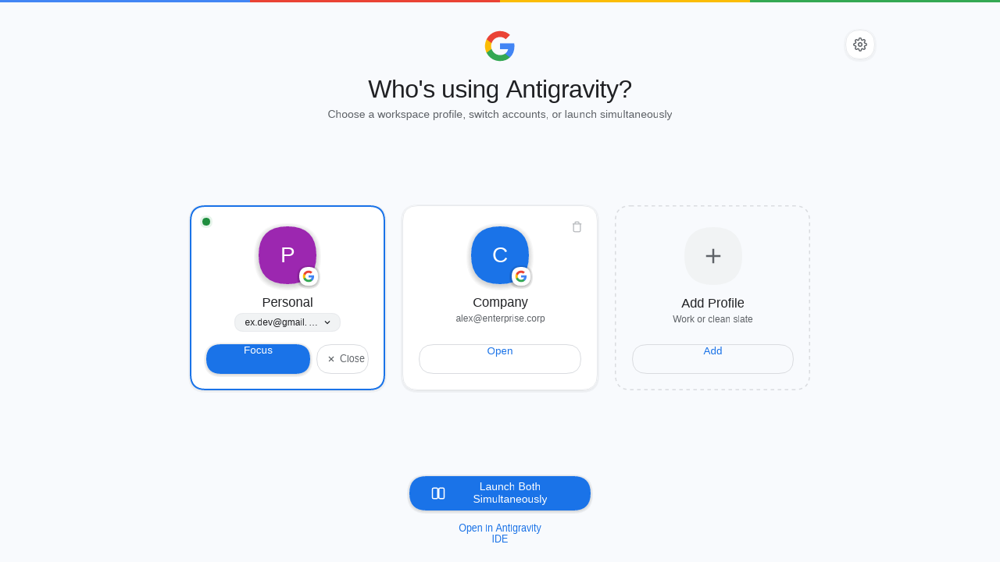
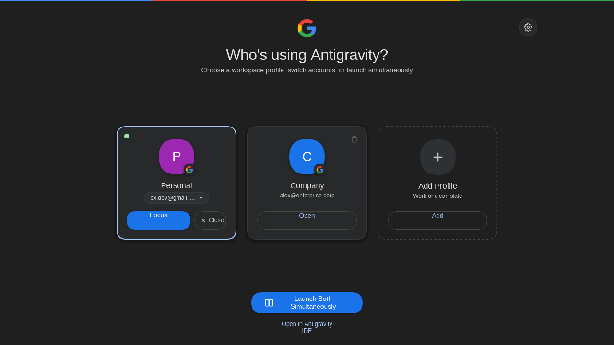
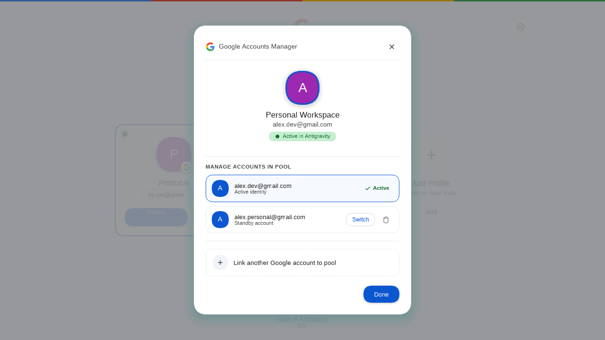
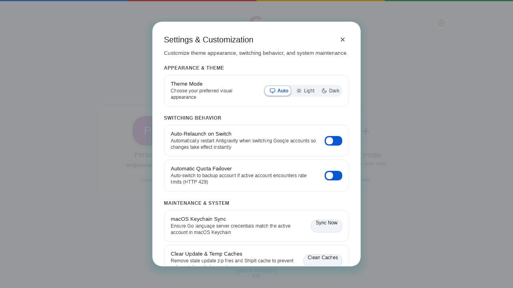

# Antigravity Switcher

A native desktop application and identity management utility for **Google Antigravity**. Switch between multiple personal Google accounts seamlessly, manage isolated workspaces (Personal vs Company / Work), and protect against quota rate limits (HTTP 429) with automatic failover.

<div align="center">

[](https://github.com/Madan019/antigravity-switcher/releases/latest)
[](https://github.com/Madan019/antigravity-switcher/releases/download/v2.0.0/Antigravity-Switcher-macOS.dmg)
[](https://github.com/Madan019/antigravity-switcher/releases/download/v2.0.0/Antigravity-Switcher-Windows.zip)
[](https://github.com/Madan019/antigravity-switcher/releases/download/v2.0.0/Antigravity-Switcher-Linux.tar.gz)

### [⬇️ Download Latest Release (v2.0.0)](https://github.com/Madan019/antigravity-switcher/releases/latest)

| Platform | Recommended Package | Alternate / Portable |
| :--- | :--- | :--- |
| ** macOS** | [**Antigravity-Switcher-macOS.dmg**](https://github.com/Madan019/antigravity-switcher/releases/download/v2.0.0/Antigravity-Switcher-macOS.dmg) (Drag & Drop) | [macOS .zip](https://github.com/Madan019/antigravity-switcher/releases/download/v2.0.0/Antigravity-Switcher-macOS.zip) |
| **⊞ Windows** | [**Antigravity-Switcher-Windows.zip**](https://github.com/Madan019/antigravity-switcher/releases/download/v2.0.0/Antigravity-Switcher-Windows.zip) (Double-click `install.bat`) | Standalone `launch.bat` |
| **🐧 Linux** | [**Antigravity-Switcher-Linux.tar.gz**](https://github.com/Madan019/antigravity-switcher/releases/download/v2.0.0/Antigravity-Switcher-Linux.tar.gz) (Run `./install.sh`) | `python3 switcher_gui.py` |

</div>

---

## Key Highlights

- **Multi-Account Personal Pool**: Add multiple Google accounts (e.g. primary account and backup quota accounts) to your Personal workspace without losing your existing conversations or project histories.
- **5-Tier Identity Synchronization**:
  1. macOS Keychain (`security add-generic-password -s gemini -a antigravity`) for the language server.
  2. Google Accounts registry (`~/.gemini/google_accounts.json`).
  3. Standalone OAuth Token cache (`~/.gemini/jetski-standalone-oauth-token`).
  4. SQLite State Database (`state.vscdb` - `antigravityAuthStatus`, `antigravityUnifiedStateSync.userStatus`, `agy.onboarding.lastLoginUsername`).
  5. Application Storage (`app_storage.json`).
- **Isolated Workspace Profiles**: Run separate environments (such as Company / Work) with dedicated settings, isolated chats, and independent tokens.
- **Simultaneous Instances**: Launch Personal and Company workspaces side-by-side in separate native windows.
- **Google Material Design 3 (M3) UI**: Authentic Google profile picker aesthetic with light/dark theme toggle, Google brand colors, smooth card interactions, and window dragging.
- **Safety Guards**: Active accounts are protected from accidental deletion.

---

## Screenshots & Visual Walkthrough

### ☀️ Light Theme & 🌙 Dark Theme
| Light Mode (Material 3) | Dark Mode (Google Dark) |
| :---: | :---: |
|  |  |

### 🔑 Google Accounts Manager & ⚙️ Settings
| Multi-Account Pool Switching | Preferences & Theme Settings |
| :---: | :---: |
|  |  |

---

## Project Structure

```
antigravity-switcher/
├── AntigravitySwitcher.swift      # Native Swift AppKit wrapper & process manager (macOS)
├── switcher_gui.py               # Cross-platform desktop GUI launcher (Windows & Linux)
├── account_switcher_core.py       # Core synchronization engine across 5 identity tiers
├── ui.html                       # Google M3 Webview UI (Accounts manager & Settings)
├── install.sh                    # 1-click build & install for macOS
├── install.bat / install.ps1     # 1-click installer & shortcut creator for Windows
├── install_linux.sh              # 1-click desktop integration for Linux
├── launch.bat                    # Portable launcher for Windows
├── package_release.sh            # Packages .dmg, .zip, and .tar.gz distribution archives
└── .gitignore                    # Git ignore file
```

---

## Installation & Setup

###  macOS
1. Download **[Antigravity-Switcher-macOS.dmg](https://github.com/Madan019/antigravity-switcher/releases/download/v2.0.0/Antigravity-Switcher-macOS.dmg)**.
2. Open the disk image and drag **Antigravity Switcher.app** to your `Applications` folder.
3. Launch from Spotlight (<kbd>⌘</kbd> + <kbd>Space</kbd> `Antigravity Switcher`) or Launchpad.

*Build from source:*
```bash
git clone https://github.com/Madan019/antigravity-switcher.git && cd antigravity-switcher
chmod +x build.sh install.sh && ./install.sh
```

### ⊞ Windows (10 & 11)
1. Download and extract **[Antigravity-Switcher-Windows.zip](https://github.com/Madan019/antigravity-switcher/releases/download/v2.0.0/Antigravity-Switcher-Windows.zip)**.
2. Double-click **`install.bat`** (or right-click `install.ps1` -> *Run with PowerShell*).
3. The installer creates Start Menu and Desktop shortcuts and launches the app.

### 🐧 Linux (Ubuntu, Debian, Fedora, Arch)
1. Download and extract **[Antigravity-Switcher-Linux.tar.gz](https://github.com/Madan019/antigravity-switcher/releases/download/v2.0.0/Antigravity-Switcher-Linux.tar.gz)**:
```bash
tar -xzf Antigravity-Switcher-Linux.tar.gz
cd antigravity-switcher
chmod +x install.sh && ./install.sh
```
2. Launches directly and registers an Application Menu entry in your desktop environment.

---

## CLI Usage

The core engine can also be executed directly from the terminal:

```bash
# Check current active account
python3 account_switcher_core.py active

# Switch to a saved account in your pool
python3 account_switcher_core.py switch <email>

# Backup current account credentials
python3 account_switcher_core.py backup <email>

# Remove an account from pool (cannot delete active account)
python3 account_switcher_core.py delete <email>

# Force re-sync active token to macOS Keychain
python3 account_switcher_core.py resync-keychain

# Clear temporary updater archives and cache files
python3 account_switcher_core.py clean-caches
```

---

## Authors & Contribution

Created by [Madanlal Bidiyasar](https://github.com/madan019). Contributions and improvements are welcome!
